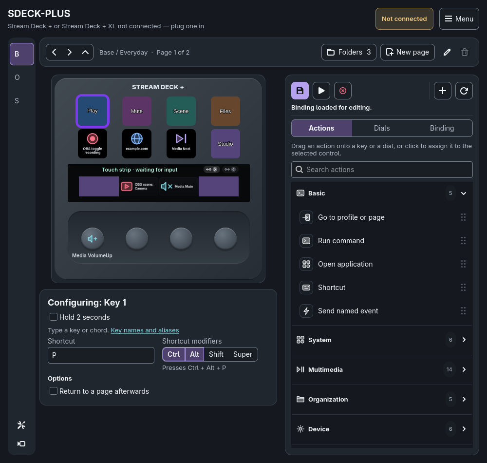

# sdeck-plus


[](LICENSE)

> [!NOTE]
> New features will be released over time.

sdeck-plus is a native GTK4 control desk for the Elgato Stream Deck +
(VID `0x0FD9`, PID `0x0084`) and the Stream Deck + XL (PID `0x00C6`) on Linux,
developed on Arch Linux with Hyprland. It configures the keys, dials and touch
strip, shows live information on them and runs desktop, media, audio and OBS
Studio actions.

| Model | Controls | Status |
|-------|----------|--------|
| Stream Deck + | 8 keys, 4 dials, touch strip with 4 sections | Developed and tested on this hardware. |
| Stream Deck + XL | 36 keys, 6 dials, touch strip with 6 sections | Implemented from [Elgato's HID documentation](https://docs.elgato.com/streamdeck/hid/stream-deck-plus-xl) and validated with a simulated device; real-hardware validation is pending. |

The app detects the connected model and shows its preview; **Preview as** lets
you configure either model without a device, and each model keeps its own
profiles. Other Elgato models are prepared in the model registry but are not
supported yet; see [DEVICES.md](DEVICES.md).

**Website and full documentation:** <https://aldosilvestre.github.io/sdeck-plus/>



## Why

Elgato's own software does not run on Linux. sdeck-plus gives Linux desktop
users a native, local application for every control of the Stream Deck + and
Stream Deck + XL,
with no account, cloud service or system-wide changes required. It runs in the
tray, keeps working with its window closed and never installs packages or changes
permissions on its own.

## Features

- **Every control:** the keys, the dials with press and clockwise/counterclockwise
  bindings, and touch-strip sections with tap, hold, flick and swipes.
- **Profiles, pages and folders:** profile tabs switched automatically by the
  focused application (Hyprland), plus touchscreen pages navigated by swiping.
- **Artwork, button text and action icons** on keys, the touch strip and its zones.
- **Live information:** volume, audio output, time, weather, CPU, memory,
  temperature, device brightness, OBS state and now playing, updated on the
  device.
- **Actions:** commands, applications, keyboard shortcuts, media and volume
  control (configurable volume step, default 5%), audio-output switching, sounds, brightness, timers and page returns.
- **OBS Studio:** switch scenes, toggle recording and streaming, mute inputs and
  show or hide sources over the local WebSocket server.
- **System tray** with optional start at login.
- **Light and dark GTK themes** following the desktop.
- **Configuration backup and restore** through a single readable metadata-only export file (no base64);
  images, sounds and other files use relative references and stay local.

## Installation

Requirements: the Rust stable toolchain, a C toolchain, `pkg-config`,
`glib-compile-resources`, GTK 4.8 or newer, libudev development files and a
StatusNotifierItem tray. On Arch Linux:

```sh
sudo pacman -S gtk4 base-devel
```

Install for the current user (no root; files go under `~/.local`):

```sh
curl -fsSL https://raw.githubusercontent.com/aldosilvestre/sdeck-plus/main/install.sh | bash
```

A published GitHub release tagged `vX.Y.Z` is required, and the `version` in that release's `Cargo.toml` must equal `X.Y.Z` (otherwise the installer stops before building). With `curl` and GNU
`tar` available, the installer downloads the latest release and builds it with
`Cargo.lock`. Sources, build output and the temporary Cargo cache are removed
on success, failure or interruption; only the binary, launcher, icon and license
are installed. Existing Cargo caches and checkouts are not removed.
To pin a release, append `-s -- --tag vX.Y.Z` to `bash` in the command above
(or use `--tag=vX.Y.Z`); this option is rejected in checkout mode.

For the default `~/.local/bin/sdeck-plus` installation, **Menu > Updates**
offers **Update** after finding a newer stable release. Only pressing it runs
that release's installer from GitHub, pinned to the detected tag. After success,
choose **Restart now** when ready; the old instance releases the device before
its replacement starts. Packages under `/usr` (including pacman/AUR installs)
must be updated with their package manager; checkouts and custom prefixes show
manual-install guidance instead. See the [update documentation](https://aldosilvestre.github.io/sdeck-plus/docs.html#configuration)
for execution limits and failure handling.

Uninstall using the same prefix/data settings; your configuration is kept:

```sh
curl -fsSL https://raw.githubusercontent.com/aldosilvestre/sdeck-plus/main/install.sh | bash -s -- --uninstall
```

Alternatively, clone the repository and run `./install.sh` to build that checkout
(without requiring a published release), or `./install.sh --uninstall` to remove
it. To try it without installing, run `cargo run` from the checkout.

### Device access (udev rule)

Your user needs permission to open the device's HID node. If access is denied, an
administrator has to install the repository's rule file,
[`udev/70-sdeck.rules`](udev/70-sdeck.rules). It grants the logged-in user access
to the Stream Deck + (`0fd9:0084`) and the + XL (`0fd9:00c6`) with `TAG+="uaccess"`
and nothing else. It can be installed in either of two ways:

**With one command (downloads the file and writes it with `sudo`):**

```sh
curl -fsSL https://raw.githubusercontent.com/aldosilvestre/sdeck-plus/main/udev/70-sdeck.rules | sudo tee /etc/udev/rules.d/70-sdeck.rules >/dev/null
```

**Or copy it by hand:** read [`udev/70-sdeck.rules`](udev/70-sdeck.rules) first, then copy
it to `/etc/udev/rules.d/70-sdeck.rules`, for example from a checkout of the repository:

```sh
sudo install -Dm644 udev/70-sdeck.rules /etc/udev/rules.d/70-sdeck.rules
```

Either way, reload the rules and reconnect the device afterwards:

```sh
sudo udevadm control --reload-rules && sudo udevadm trigger
```

The installer prints these commands when it finds a device your user cannot open, and the
AUR packages ship the rule (no manual step). sdeck-plus itself never changes permissions.

Some actions need optional tools such as `mpv`, `wpctl` or `wl-copy`, and keyboard actions
need `/dev/uinput` access. See [Install](https://aldosilvestre.github.io/sdeck-plus/docs.html#install)
for the full list and installer options.

## Documentation

- [Features](https://aldosilvestre.github.io/sdeck-plus/#features) and
  [Actions](https://aldosilvestre.github.io/sdeck-plus/#actions): what each part does.
- [Supported devices](https://aldosilvestre.github.io/sdeck-plus/docs.html#devices): models,
  detection, **Preview as**, per-model data and validation status; [DEVICES.md](DEVICES.md)
  explains how models are added.
- [Configuration](https://aldosilvestre.github.io/sdeck-plus/docs.html#configuration): controls,
  touchscreen pages, profiles, artwork, OBS setup, data files, tray and startup.
- [Development](https://aldosilvestre.github.io/sdeck-plus/docs.html#development): checks,
  documentation screenshots, real-device checks and code organization.

The site is published from [`docs/`](docs/index.html); changes are tracked in
[CHANGELOG.md](CHANGELOG.md).

## License

sdeck-plus is distributed under the [MIT license](LICENSE).
Copyright (c) 2026 Aldo Silvestre. The license also appears in **About**.
