# sdeck-plus


[](LICENSE)

> [!NOTE]
> This project is still under construction.

sdeck-plus is a GTK4 control desk for the Elgato Stream Deck + (VID `0x0FD9`, PID `0x0084`) on Arch Linux. Configure actions for eight keys, four encoders and touch-strip gestures, organize profiles into folders and pages, assign artwork, control device brightness and connect to OBS Studio.

## Screenshots

All captures are in [`docs/screenshots`](docs/screenshots) and show the
application running against a connected Stream Deck +.

**Main window.** Connection status, profile tabs, page navigation, the
hardware preview with the assigned artwork, and the binding editor for the
selected control.

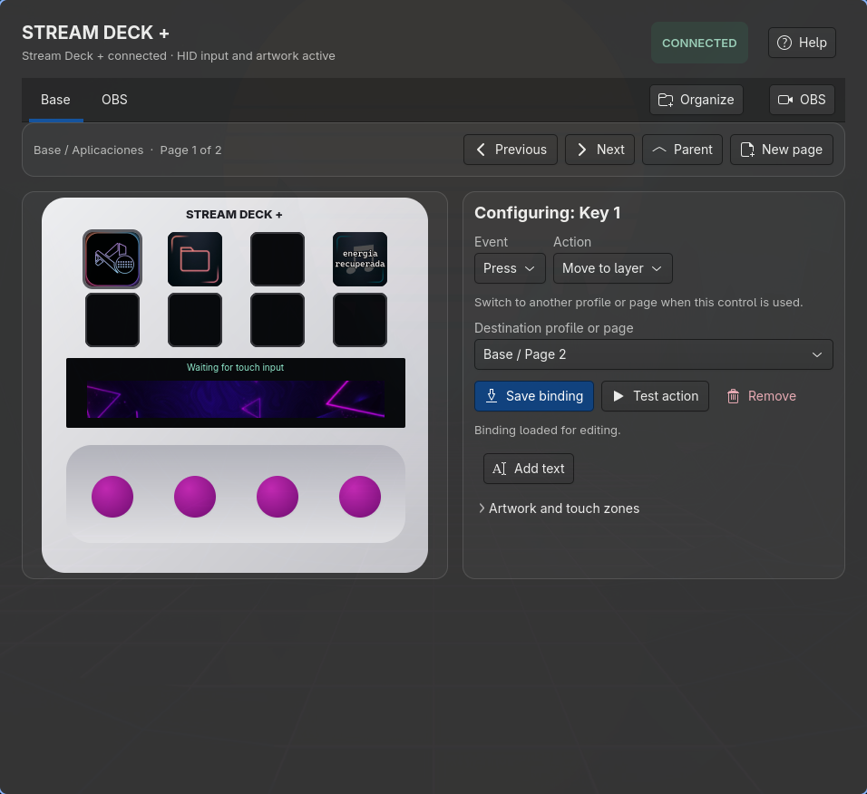

**Action types.** The **Action** menu offers layer/page switching, shell
commands, launching applications, keyboard shortcuts, legacy events, the
categorized **More actions** and **Play sound**.

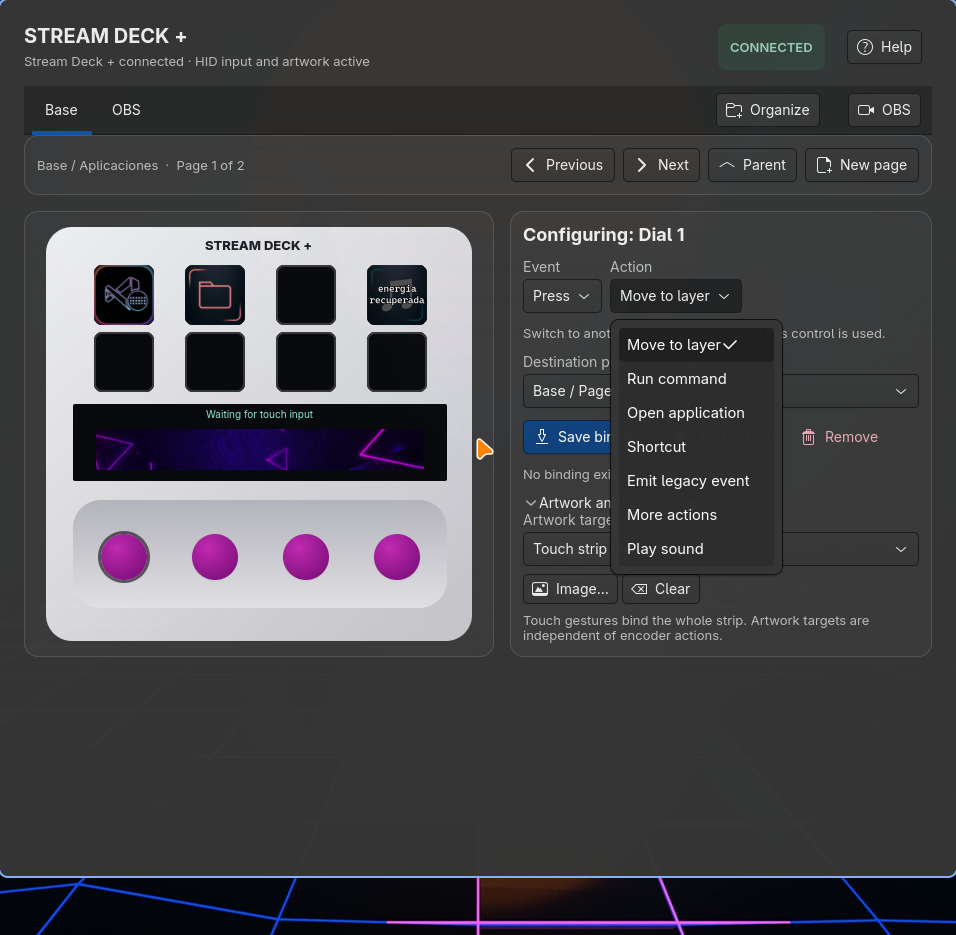

**More actions categories.** **More actions** groups the extended actions
into System, Multimedia, Organization, Device and OBS.

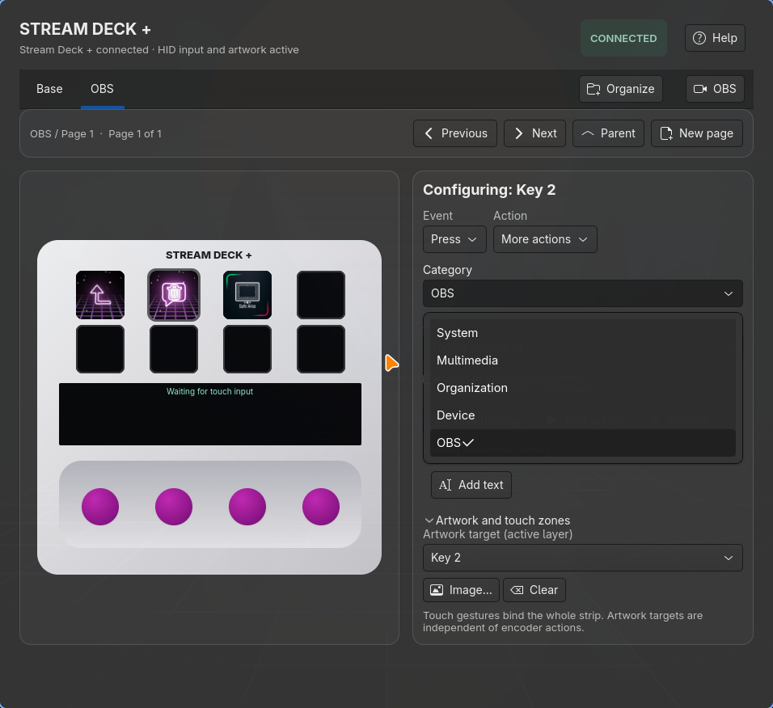

**More actions binding.** A key bound to **OBS > Toggle recording**: each
action shows only its own fields and a short description of what it does.

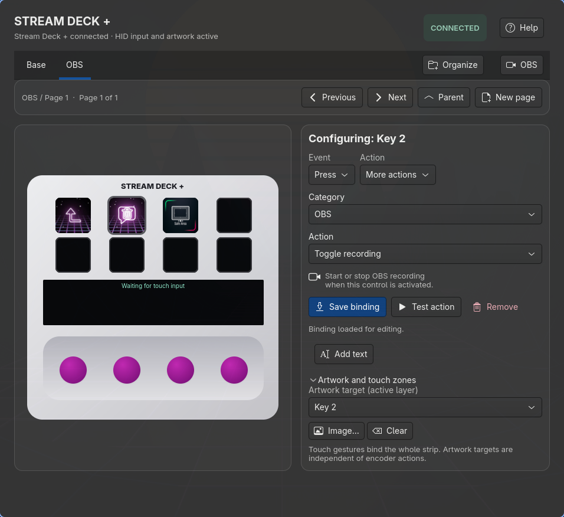

**Encoder events.** Each dial has independent **Press**, **Clockwise** and
**Counterclockwise** bindings.

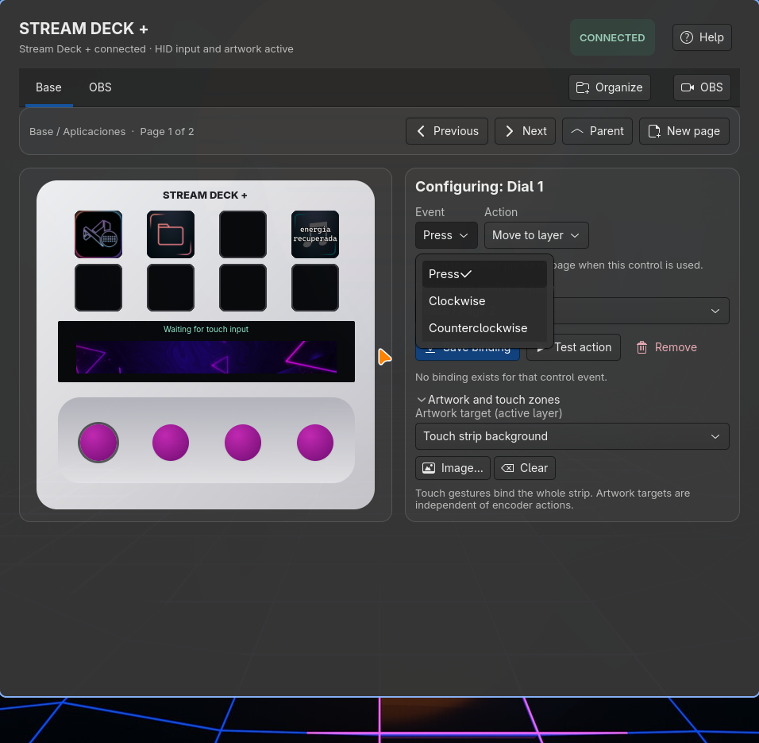

**Touch strip gestures.** Selecting the strip configures its gestures (tap,
hold, flick and directional swipes) and targets the strip background artwork.

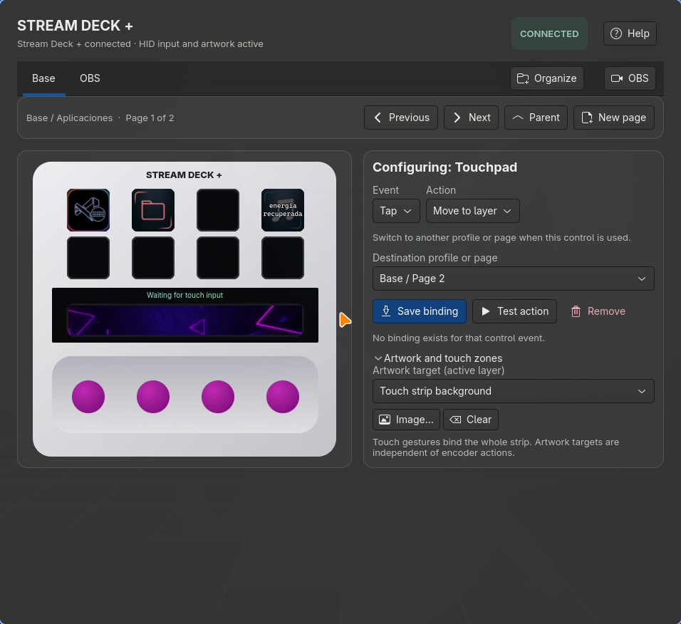

**Button text.** **Add text** opens the text editor: font, size, orientation
and alignment, with a live preview of the key composition.

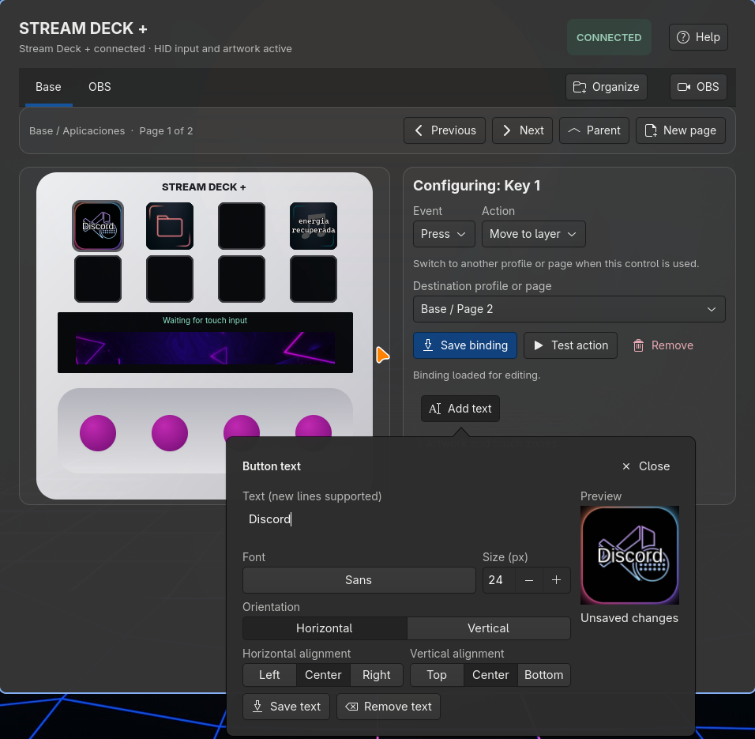

**Artwork and touch zones.** Choose any of the thirteen artwork targets for
the active layer and assign or clear its image.

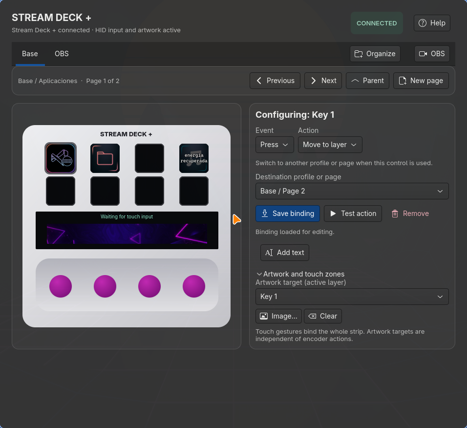

**Profiles, pages and folders.** **Organize** creates profiles, renames the
current page and associates a profile with an application.

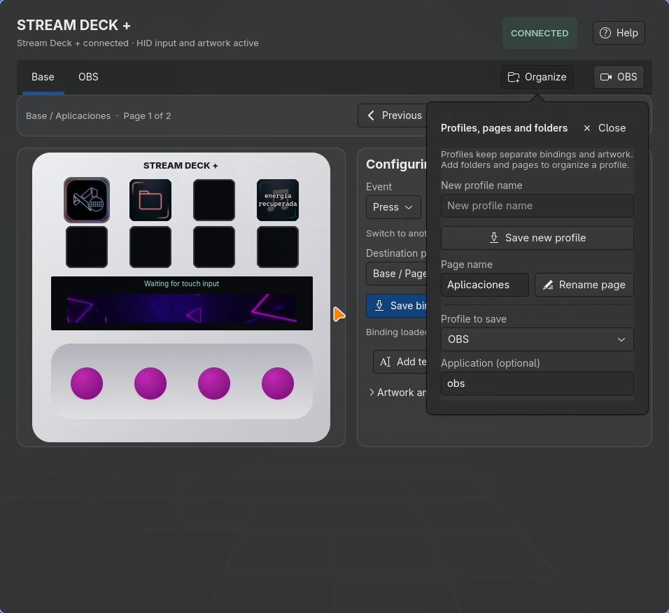

**Application profiles.** Each profile is a tab with its own pages, bindings
and artwork. Here the **OBS** profile, associated with the `obs` application,
shows its own keys.

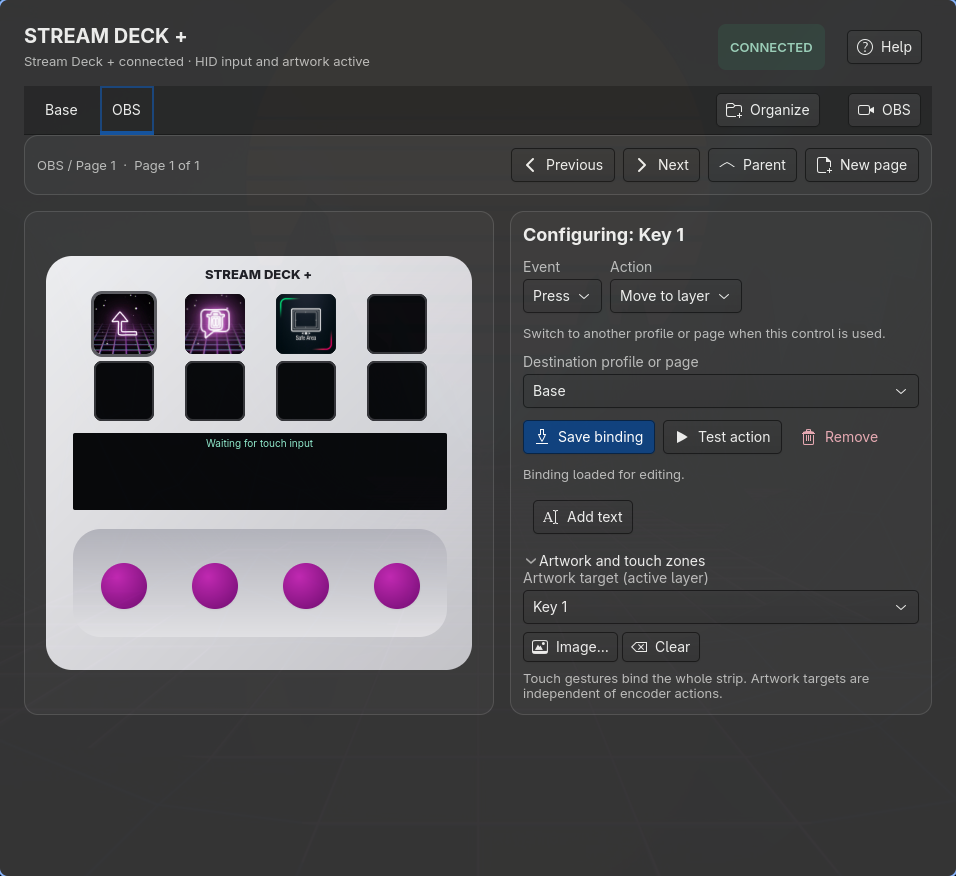

**OBS Studio.** Local WebSocket endpoint and masked password, with a
connection test that only queries OBS state.

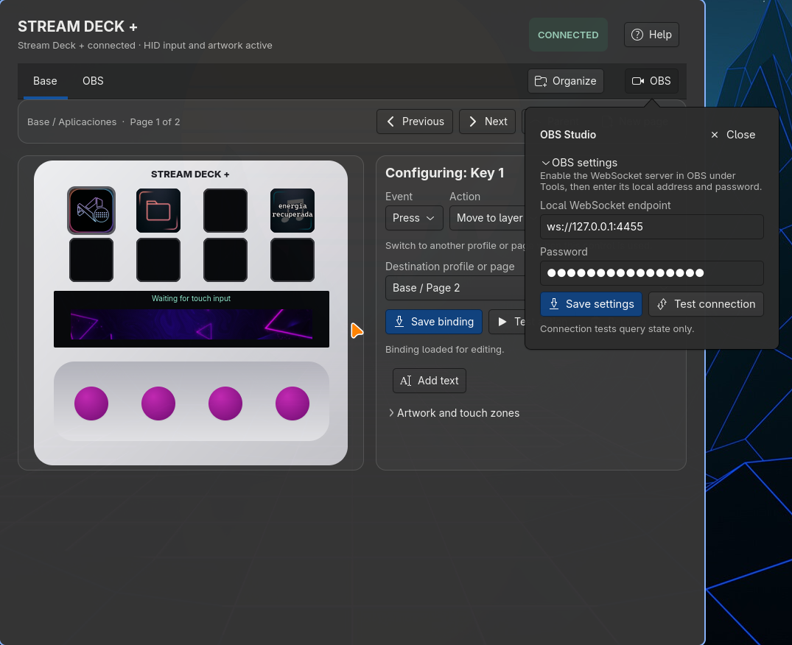

**Setup help.** A three-step guide: select a control, configure an action,
then save or test it.

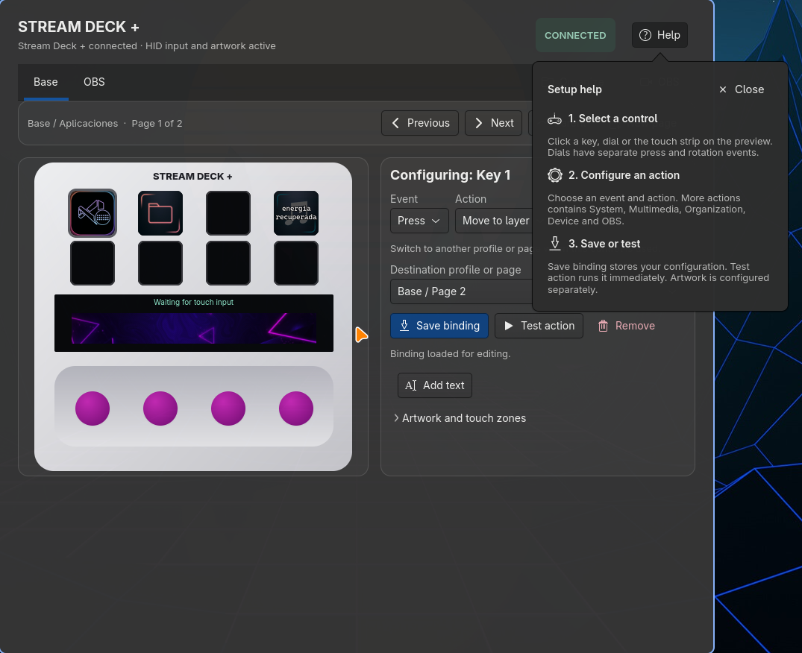

## Requirements

- Rust stable toolchain and Cargo.
- GTK 4.8 or newer development files and a C toolchain. On Arch Linux: `sudo pacman -S gtk4 base-devel`.
- A desktop tray supporting StatusNotifierItem (for example, the Omarchy tray).
- Stream Deck + connected over USB for live device events.
- Permission to open the device's HID node. If access is denied, use the distribution's supported device-access mechanism (for example, an administrator-installed narrowly scoped udev rule for this VID/PID with `TAG+="uaccess"`), then reconnect the device. The application does not change host permissions.
- Action-specific tools: `xdg-utils` for opening files/websites, `wireplumber` (`wpctl`) for PipeWire volume, `wl-clipboard` for Wayland text pasting, `procps-ng` for closing a named process, and `mpv` for soundboard playback. Keyboard and mouse-wheel actions require effective `/dev/uinput` access; media transport requires an MPRIS-capable player. Missing tools or access are reported; the app never installs packages or changes permissions.

## Build and run

Run these commands from the `sdeck-plus` checkout:

```sh
cargo run
```

The UI displays connection state, eight keypad states, four encoder button/rotation states, and Touch Strip Tap, Press, and Flick coordinates in Elgato's 800 × 100 logical-pixel space. Touch gestures are reported after the interaction completes, not as separate contact start/release events. If the device is absent, inaccessible, or disconnected, the UI remains open and reports the state; it retries detection after connection failures.

## Install for the current user

After installing the build requirements above, run:

```sh
./install.sh
```

The installer builds the native release binary using `Cargo.lock` and installs:

- Executable: `~/.local/bin/sdeck-plus`.
- Application-menu launcher: `~/.local/share/applications/dev.streamdeck.EventMonitor.desktop`.
- Icon: `~/.local/share/icons/hicolor/scalable/apps/sdeck-plus.svg`.
- MIT license: `~/.local/share/doc/sdeck-plus/LICENSE`.

`PREFIX` overrides the executable prefix, and an absolute `XDG_DATA_HOME`
overrides the desktop-data directory. `CARGO_TARGET_DIR` controls build output.
Run `./install.sh --help` for usage. The installer can be invoked from any
working directory; it refuses to run as root and does not install system
packages, change device permissions, enable autostart or launch the application.
Re-running it updates the installed files.

After installing, it reports anything that needs your attention:

- The executable directory is missing from `PATH`.
- A running sdeck-plus still uses the previous executable.
- **Start at login** points at another executable; disable it and re-enable it
  from the installed application to update the saved path.
- Optional action tools (`mpv`, `wpctl`, `wl-copy`, `xdg-open`) are missing.
- A connected Stream Deck + cannot be opened by your user; it prints the udev
  rule an administrator can install, without running it.

To remove the installed files:

```sh
./install.sh --uninstall
```

Uninstalling keeps configuration, profiles, artwork and any **Start at login**
entry, and does not stop a running instance. Use the same `PREFIX` and
`XDG_DATA_HOME` values that were used to install.

## System tray and session startup

Closing the configuration window hides it. Device communication, bindings,
artwork replay, timers, and app-owned playback remain active until **Quit**.
Left-click or right-click the tray icon to open the same menu:

- **Open configuration** reopens the existing configuration window.
- **Start at login** enables or disables per-user session autostart; its checkmark reflects the saved state.
- **About** opens the native sdeck-plus dialog with its version, description, author, copyright, and complete MIT license.
- **Quit** stops the application and removes its tray icon.

Autostart uses `$XDG_CONFIG_HOME/autostart/sdeck-plus.desktop`,
or `$HOME/.config/autostart/sdeck-plus.desktop` when XDG config
home is unset or relative. It starts the current executable with `--background`,
without opening configuration. Keep that executable at the same path, or
disable and re-enable autostart after moving it. For a quiet manual startup:

```sh
cargo run -- --background
```

Repeated launches reuse the running application and configuration window.
If connecting to the session bus fails, configuration remains accessible and
reports the error; closing it exits instead of hiding an unreachable application.
When autostart precedes the desktop tray, the notifier waits for the host.

### Existing configuration

The application, Cargo package and executable are named **sdeck-plus**.
The application ID remains stable so repeated launches reuse the same instance.
The XDG data directory is now `sdeck-plus` and the autostart entry is
`sdeck-plus.desktop`. When upgrading from the previous name, quit the old
application and move its data directory to the new path before launching
to retain profiles, artwork and OBS settings. Disable the previous autostart
entry and re-enable **Start at login** with the new executable.
Existing files are not migrated automatically.

## Graceful shutdown

**Quit** discards pending artwork uploads, removes UI polling, turns off display brightness, clears all eight keys and the full touch strip to black, and joins the HID worker to release the device. Application shutdown repeats this cleanup safely as a fallback. A synchronous HID call already admitted before cancellation may finish; shutdown waits for it, so a blocked driver call can delay exiting. Only the final display cleanup reports are sent after cancellation; failures are logged without preventing device release.

Saved artwork and profiles are preserved. On the next launch, brightness is restored to 100% and saved artwork is replayed. Unplug/reconnect retries and artwork replay remain active while the application is running, even with configuration hidden; hiding configuration does not turn off or clear the device. Quitting cancels the timer and explicitly stops the action worker, which releases app-owned soundboard playback. Independently opened applications remain open.

## Local artwork

### Button text

Select a key and click **Add text** in its configuration panel. Once text is
saved, **Edit text** reopens the same popup with the saved settings.
Choose an installed font, a size from 6 to 120 pixels, horizontal or vertical
orientation, and separate horizontal and vertical alignment. Vertical rotates
the whole text 90 degrees clockwise; new lines are supported. Text is white
with a black outline and is drawn over the background image, or over black
when no image is assigned. Oversized text is clipped to the key.

The enlarged preview and the key preview show the same composition sent to
the device. **Save text** applies and persists the settings for that key in the
active profile/page and closes the popup. Closing without saving discards
draft changes. **Remove text** keeps the
background image; clearing the background keeps the text. Text settings are
restored when reopening the application or switching profiles/pages.

### Background images

Select **Artwork target (active layer)** in the right settings panel, then use the shared **Image…** or **×** (Clear artwork) controls. All thirteen targets are available: eight keys, the Touch Strip background, and four touch zones. Clicking a key or touch zone also selects its artwork target. Clicking an encoder selects only its action binding; use the artwork selector explicitly to choose an image region. PNG and GIF files are explicitly available in the picker; a separate filter includes all image formats supported by the installed GdkPixbuf loaders. GIF artwork is uploaded as a static still image; animation is not supported by the hardware JPEG upload format. Artwork previews preserve aspect ratio and are center-cropped to fill their surfaces. Images are center-cropped to cover the device target and sent as correctly sized JPEGs over USB HID. The eight keys use 120 × 120 images; the Touch Strip background uses 800 × 100 and each encoder overlay uses a 200 × 100 region. The background and zone images can be layered. A failed import leaves the current assignment unchanged. **×** (Clear artwork) removes the local assignment; clearing a key sends a black key image, while clearing a Touch Strip image rebuilds the strip from its saved background (or black) and remaining zone images. It does not issue a separate device clear command.

Images are copied into the application's XDG data directory, so the original files may be moved or deleted after assignment. The assignment manifest is stored beside the copied assets. The default path is `$XDG_DATA_HOME/sdeck-plus` (normally `~/.local/share/sdeck-plus`); when `XDG_DATA_HOME` is unset, the application uses `$HOME/.local/share/sdeck-plus`. Artwork is independent per layer. Legacy global assignments migrate into the active layer (or `Base` if unavailable); other layers start empty. Selecting a layer refreshes all thirteen previews and replaces the device's complete image state: unassigned keys become black, and the strip is rebuilt from its background (or black) followed by assigned zones. The same state is replayed after reconnect, so empty layers clear previous images. A chooser saves to the artwork target and layer captured when it was opened, even if you change the selected control, artwork target, or layer before accepting; acceptance is rejected if that layer was removed, even if another layer was created with the same name. Storage open or migration failures show a repair message and disable artwork writes and layer removal rather than saving an empty fallback. Layer removal is aborted if artwork cleanup cannot be persisted. Upload failures are shown in the connection status; local assignments remain saved if a device write fails.

## Application layers and actions

Layers and action bindings are stored independently in `layers.conf` in the same app data directory; per-layer artwork assets and assignments remain in their separate artwork store. Create, select, or remove a named layer in **APPLICATION LAYERS**. The built-in `Base` layer cannot be removed; legacy files that named the protected layer `default` are migrated to `Base`.

To configure an action, choose the layer at the top, then select a physical control:

1. Click one of the eight buttons (two rows of four), the horizontal touch strip, or one of the four encoders beneath it. Clicking an artwork zone also selects the whole touch strip; zones are image regions, not separate gesture bindings.
2. Pick an event valid for that control: button press; encoder press/clockwise/counterclockwise; or touch tap, press-and-hold, generic swipe/flick, and directional swipes.
3. Pick an action and fill only its visible fields. The existing layer, command, application, shortcut and legacy-event choices remain available. **More actions** opens typed category-specific fields described below. Shortcuts accept a full chord such as `CTRL + D` or one key with optional modifier checkboxes.
4. Click **Save binding** to create or update that control event, or **Remove binding** to clear it. A floating toast confirms success only after the binding is written to disk; validation or saving problems show an error toast. Success disappears after five seconds; errors remain until dismissed or replaced by another notification. Saving never executes the action. Selecting an already configured control event loads its saved action for inspection and editing.

Hover a physical control to see assignments for the selected layer, including **Unassigned** events: encoders include **Press**, **CW** (clockwise), and **CCW** (counterclockwise); the touch strip includes tap, hold, flick, and directional swipes. Legacy exact-tick rotation overrides appear separately. Long action text is shortened; select the event to inspect its full saved fields. Summaries refresh after saving/removing bindings, selecting/creating/removing layers, and input-driven **Move to layer** actions. Selection highlighting is separate from live pressed-state highlighting, and live input does not replace assignment summaries. The shared **Image…** and **×** edit the explicitly selected artwork target, independently of the binding editor.

### Extended actions on Arch Linux

Choose **More actions**, a category, and an action. Saving or inspecting an
assignment never executes it. **Test action** explicitly runs the selected
action and can affect the desktop, device or OBS; test only the action you
intend to perform.

For a sound button, choose **Play sound** directly in **Action**, then use
**Choose file...** or enter an audio file path and click **Save binding**.
WAV, MP3, FLAC, OGG, M4A/AAC, Opus and other formats decoded by mpv are supported.
Choosing a file or saving never starts playback; press the assigned control or
use **Test action** to play it. Playback replaces the app's previous sound.
**More actions > Multimedia > Stop audio file** stops only app-owned playback.

| Category | Actions |
| --- | --- |
| System | Alternate two shortcuts, paste Unicode text with optional Enter, open files/folders or HTTP(S) websites, close an exact process basename, scroll the mouse wheel |
| Multimedia | Play/pause, stop, next/previous track, PipeWire volume up/down and mute, play a local audio file, stop app-owned soundboard playback |
| Organization | Next/previous/specific page, enter a named child folder, return to the parent; existing layers remain root profiles |
| Device | Absolute or relative brightness, sleep and wake; timer actions show countdown and completion |
| OBS | Select a scene, toggle recording/streaming, toggle input mute, show/hide a named source in a scene |

Text uses the Wayland clipboard and a physical Ctrl+V chord, not synthetic
Unicode keycodes. It replaces clipboard contents and requires the focused
application to support Ctrl+V. Closing an application targets its exact Linux
process basename (1-15 ASCII bytes), not a window title or a shell pattern.
Volume uses the default PipeWire output in 5% steps, capped at 100%.
Media transport uses the session's MPRIS player interface. Soundboard playback
belongs to this app and stopping it does not stop unrelated media players.

The four dials support independent press, clockwise and counterclockwise
assignments. For example, assign volume up/down to rotation and mute to press;
use relative brightness actions for another dial. Mouse wheel directions are
vertical or horizontal. The touch strip retains tap, hold and directional
swipe assignments. Device brightness is the Stream Deck's display brightness,
not monitor backlight. Sleep sets brightness to zero and wake restores the
remembered level; before an explicit absolute level, relative/wake actions use
a 100% baseline because the device protocol has no brightness readback.

Profiles appear as native tabs, with **Base** always available. Create another
profile in **Organize** using **New profile name** and **Save new profile**. Pages and
folders belong to their profile and do not create additional profile tabs.
Switching tabs restores that profile's last selected page for the current session.

To make a profile application-specific, open **Organize**, choose it under
**Profile to save**, enter a window class or executable name under
**Application (optional)**, and click **Save profile**. Both save buttons confirm
success only after writing the configuration, and report disk errors. For example,
`kitty`, `firefox`, or `obs` can match executable names; a precise window class
can distinguish windows belonging to the same executable. Leave the field
empty to disable automatic selection. All configured profiles remain visible and
manually selectable, including when their associated application is not focused.
Base cannot require an application. Unsaved application input survives focus changes.

Application detection uses Hyprland's IPC focus events, not running-process
polling. A matching external application selects its profile;
unmatched or unavailable focus returns to Base. When configuration itself
has focus, the last external application context remains active. Closing that
external window clears its retained context. A manual tab choice is retained
until the next changed external application context. Selecting a profile
never launches its application. Associations survive restarting the app.

Use **New page** beside the page indicator or **New folder** in **Organize**. Every view has
its own existing layer-backed bindings and artwork. Navigation stays within
the current profile and folder; the indicator shows the current page.
To rename the current page, open **Organize**, edit **Page name**, and click
**Rename page** (or press Enter in the name field). Names must be nonblank,
contain no control characters, and fit within 64 UTF-8 bytes. Surrounding
spaces are trimmed. The saved name appears in the page indicator and survives
restarts; page numbers, navigation, bindings and artwork remain unchanged.
`organization.json` stores this hierarchy beside `layers.conf`. Existing flat
layers load as independent profiles. Invalid metadata is retained and
organization writes are disabled until repaired. Legacy `brightness-v1` and
`scroll-v1` action records now load as the corresponding typed actions.

### OBS Studio

In OBS, enable its built-in WebSocket server under **Tools > WebSocket Server
Settings**. In this app, click **OBS** in the profile bar, enter the local endpoint
(normally `ws://127.0.0.1:4455`) and password, then save and test the connection.
The connection test queries actual scenes and recording/streaming state; it
does not start either output. Scene/source/input names must match OBS.

OBS operations run on the worker with bounded network waits and surface
authentication, connection and request failures in the UI. Only local
loopback endpoints are accepted. Credentials are stored in owner-only
`obs.json`, not action bindings, and are masked in the editor and diagnostics.
The application does not enable OBS's server or alter its configuration.

### Window layout

All controls fit without scrolling at the default 1000 × 700 logical-pixel client size: the device canvas stays on the left, action settings on the right, and layer controls above. The last-event panel has been removed; live physical states and connection/error indicators remain. Summaries and long layer names are ellipsized; tooltips show full summaries and the editor retains full saved action fields.

Every outer edge has 38 logical pixels of padding: a 10mm reference at 96dpi, not a physical measurement guarantee. Actual millimeters depend on monitor DPI and scaling. Inactive window, viewport, shell, and cards share one dark background. The physical preview intentionally contrasts: a nearly square silver chassis, two rows of four separated black square keys, a continuous black display bezel, and four round purple knobs on a recessed silver rail aligned to the key columns. The artwork strip retains its 8:1 ratio inside the wider bezel; transparent zones preserve strip-background layering. No sample artwork or audio values are rendered. Selection, live state, keyboard focus, and connection status remain distinct.

The serialized production GTK test checks the shared editor's thirteen assign/clear paths, explicit target selection, chooser ownership, reference geometry, and all five actions at 1000 × 700 with empty, loaded, and cleared artwork and long editor values, without moving scroll adjustments. It also checks 1840 × 980, 1280 × 720, and 960 × 640 horizontal fit separately. Reduced heights (including 960 × 640) may scroll vertically; 640 × 480 retains two-axis scroll reachability. Larger system fonts can also require scrolling. Window managers may override the requested startup size; no desktop resolution change is needed.

Launch arguments are passed as distinct process arguments; no shell evaluates launches. In the application-argument box, an empty box means zero arguments, `\\empty` means one empty argument, and multiple empty arguments are written on separate `\\empty` lines. Literal backslash, newline, carriage return, and tab are escaped as `\\\\`, `\\n`, `\\r`, and `\\t`, so leading/trailing spaces are preserved instead of trimmed. Command actions intentionally run `/bin/sh -c` with the configured shell string. External actions execute serially on a background worker, and failures appear in the UI without blocking GTK. Internal events remain on the in-process `MonitorEvent::AppEvent` channel and are safely consumed without a display panel. Action, persistence, and artwork-upload errors appear in the connection detail. Bindings do not inherit or fall through between layers.

### Physical keyboard actions (Linux)

**Shortcut** uses a Linux uinput virtual keyboard, not compositor shortcut dispatch, shell commands, desktop bindings, or text typing. With no modifiers, it sends one complete key down/up. With modifiers, it holds them while the main key goes down/up, then releases them in reverse order. For example, `CTRL + D` holds Control during D; `SUPER + RETURN` holds Windows/Meta during Enter. Modifiers are released after each action, not kept held between bindings. Failed sends attempt release cleanup and broken devices are discarded.

- Full chord text and checkbox modifiers are merged and deduplicated in CTRL, SHIFT, ALT, SUPER order. Checkboxes may all be empty. Names are case-insensitive; `Control` = `CTRL`, `Win`/`Windows`/`Meta` = `SUPER`, and `Return` = `Enter`. Uppercase letters do not implicitly add Shift.
- Saved legacy **Press key** actions keep working and appear in the editor as **Shortcut** with no modifiers. Inspection never rewrites saved records or key names; explicitly saving converts that binding to a canonical Shortcut. Unsupported legacy names remain visible unchanged, but validation rejects unsupported explicit saves.
- New bindings save canonical modifier/key fields and reject unknown names, empty segments, multiple main keys, or modifier-only chords. Supported keys include ASCII letters/digits, F1–F24, Enter, Tab, Escape, Space, navigation, named punctuation, keypad and media keys. Structurally valid legacy names remain loadable and unchanged; unsupported names report an actionable execution error, not a destructive migration.
- Names identify physical evdev positions. The active desktop keyboard layout determines resulting symbols; this is not Unicode text entry and does not promise indistinguishable hardware behavior.
- The serial layer worker owns one lazy, persistent keyboard. Startup and non-keyboard actions do not open uinput. First use requires effective access to `/dev/uinput` and kernel uinput support. Access/create/write failures are reported; there is no fallback or automatic privilege escalation, module loading, permission change, or desktop configuration change. Ask an administrator to assess narrowly scoped access if needed; a device node or udev tag alone does not prove effective permission.
- Creation has a bounded 200 ms discovery grace period, not proof that the compositor has recognized the keyboard. Real access, first-action delivery, compositor acceptance and layout behavior remain unverified on hardware. Automated tests use mocks only and never open or send to a real keyboard.

The versioned layer file is validated on load; malformed or unreadable layer data leaves startup configuration unavailable with writes disabled. The application shows a repair message and does not save an empty `Base` fallback over the original file; repair `layers.conf` in the app data directory and restart. Missing layer-switch targets are rejected, and removing a layer removes bindings targeting it. Legacy exact rotation bindings remain supported and are checked before directional rotation fallbacks, but the primary editor only creates the generic clockwise/counterclockwise rotation bindings.

## In-process event API

`src/event_api.rs` defines the typed `MonitorEvent` boundary: `Connection(ConnectionState)` for searching/connected/unavailable/disconnected state, `Input(protocol::Event)` for decoded HID input, and `ArtworkResult` for hardware upload results. `start_hid_monitor` returns an owned `HidController` with an artwork sender, explicit cancellation, and idempotent joined cleanup. It owns HID initialization, interruptible retry waits, timed input reads, and serialized image writes on one producer thread. Consumers ignore the `Heartbeat` liveness probe; losing the event consumer also ends the worker. GTK submits complete desired artwork snapshots through an in-process channel; only the newest pending snapshot is applied, replacing obsolete disconnected state. GTK consumes input/upload results with a short GLib timer, so device I/O does not block rendering or input handling. This phase has no TCP/HTTP/WebSocket listener or external API server. A future external transport can subscribe behind this event boundary without changing protocol decoding or UI event semantics.

## Development checks

```sh
cargo fmt --check
cargo test --offline
cargo clippy --offline --all-targets --all-features -- -D warnings
```

The single GTK widget test uses the production widget constructor without starting HID/action workers. Run `cargo test --offline -- --nocapture` in a display session to see the executed sizing/reachability markers; without a display it explicitly reports a skip. Measurements are layout checks, not a substitute for manual visual, chooser, and device verification.

The protocol decoder validates report ID and declared little-endian payload length before decoding supported input commands. Hardware event behavior requires a connected, accessible Stream Deck +.

### Opt-in real-device checks

Close other instances before these checks so one production HID worker owns
the device. The first command sends real feature reports: brightness 50%,
relative adjustment, sleep and wake. It leaves the remembered brightness at
50%. The second waits up to 60 seconds for a physical key press, dial rotation
and touch-strip gesture.

```sh
cargo run --offline --example verify_streamdeck -- --device-controls
cargo run --offline --example verify_streamdeck -- --input
```

To check a running local OBS instance without starting recording or streaming:

```sh
cargo run --offline --example verify_obs -- "$HOME/.local/share/sdeck-plus"
```

The OBS check authenticates, queries scenes/output state, then reselects its
already-current scene. Configure `obs.json` through the app first.

The other opt-in checks paste exact Unicode into their own GTK window and
exercise mpv on an isolated D-Bus session. The multimedia fixture must be a
local silent audio file; it requires the `mpv-mpris` plugin.

```sh
cargo run --offline --example verify_desktop
dbus-run-session -- cargo run --offline --example verify_multimedia -- /path/to/silent.wav
```

## Code organization

| File | Responsibility |
| --- | --- |
| `src/main.rs` | Application startup, configuration window, worker lifecycle and the single GTK-owner test fixture |
| `src/tray.rs` | StatusNotifier menu, GTK command dispatch and native About dialog |
| `src/autostart.rs` | Per-user XDG session startup entry |
| `src/ui.rs` | Shared native controls, feedback and secondary panels |
| `DESIGN.md` | Native layout, interaction and accessibility contract |

Keep device work off the GTK thread. Closing configuration must not stop
bindings, polling or timers; application shutdown owns cleanup. GTK widget
checks must keep a single owning test thread, even when test helpers move
to separate files. Run the development checks above after changing either
production code or its tests.

## License

sdeck-plus is distributed under the [MIT license](LICENSE).
Copyright (c) 2026 Aldo Silvestre. The license also appears in **About**.
